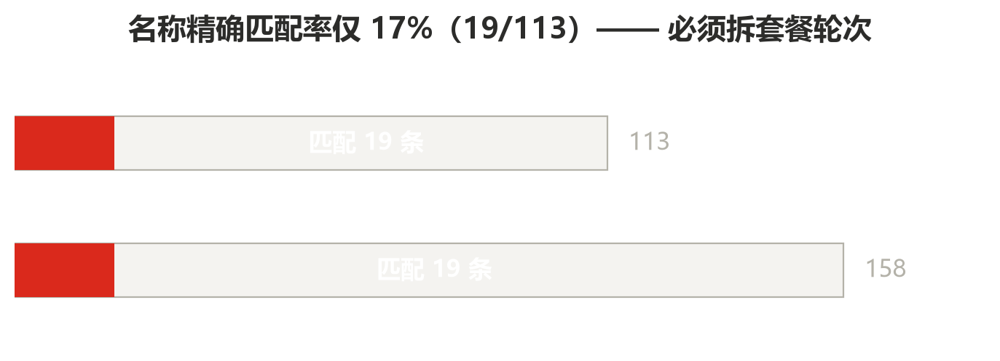
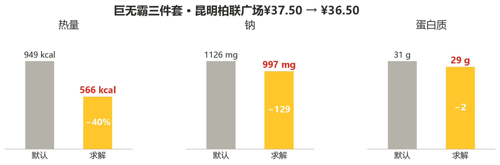
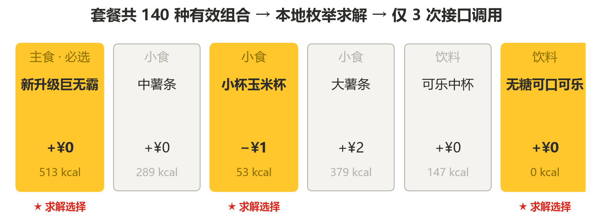

<div align="center">

# MCD Combo Solver

**同样的钱，在麦当劳能买到更好的搭配**

在真实门店菜单里做**套餐轮次级求解** —— 把套餐拆成主食/小食/饮料三个轮次，
在 140 种组合里找出最优解。

[](https://www.python.org/)
[](https://open.mcd.cn/mcp)
[](LICENSE)

</div>

> ⭐ **本项目正在参加 [麦当劳程序员创意开发大赛](https://github.com/M-China/mcd-developer-innovation-challenge)，排名只按 GitHub Star 数计。**
>
> 如果「省 ¥1、热量降 40%」对你有用，麻烦点一下右上角的 **Star** 支持一下 👉
> [`aning89404436/mcd-combo-solver`](https://github.com/aning89404436/mcd-combo-solver)（只需要点一下，不用注册什么）
>
> 下面是**实测**数据，不是 demo 演示：价格用官方 `calculate-price` 接口逐项核过。

---

## 它解决的问题

麦当劳 MCP 提供了 35 个工具，营养数据也有。但有一个**所有人都会撞上的墙**：

| 数据 | 实测值 |
|:---|---:|
| 门店菜单餐品数 | 113 |
| 营养库条目数 | 158 |
| **名称精确匹配率** | **17%**（19/113） |

原因很直接：营养库是**单品名**（`巨无霸`），菜单里大量是**套餐名**（`巨无霸三件套`）。



- 不拆轮次 → 算不出套餐的真实营养
- 拆轮次 → 113 个餐品 = 113 次调用，**撞 600 次/分钟限流**

**本项目的解法：本地枚举 → 硬约束过滤 → 只对 Top-K 调接口。**

```
巨无霸三件套组合空间：140 种
本地枚举 140 组合 → 只调 3 次 MCP 算价      压缩 46.7 倍
```

---

## 实测效果

以昆明柏联广场门店（`3570220`）的巨无霸三件套为例：

| 配置 | 价格 | 热量 | 蛋白 | 钠 |
|:---|---:|---:|---:|---:|
| 默认（中薯条 + 可乐） | ¥37.50 | 949 kcal | 31.0 g | 1126 mg |
| **求解结果（小杯玉米杯 + 无糖可乐）** | **¥36.50** | **566 kcal** | 29.0 g | **997 mg** |

**省 ¥1，热量低 383 kcal（−40%），钠低 129 mg。**



三个改动，每个都来自官方实时数据：

| 改动 | 依据 | 效果 |
|:---|:---|:---|
| 中薯条 → **小杯玉米杯** | `diffPrice` 实测 **−¥1**（唯一减价项） | 289 → 53 kcal |
| 可乐 → **无糖可口可乐** | `diffPrice` 实测 **±¥0**（同价） | 147 → **0** kcal |
| 保留巨无霸本体 | 轮次 1 必选，不可换 | 513 kcal |



价格不是估算的 —— 已用官方 `calculate-price` 接口验证，两者**完全一致**：

| | 价格 |
|:---|---:|
| 本项目静态计算 | 3650 分 |
| **官方 `calculate-price`** | **3650 分** |

同价位还有另外两个候选（雪碧 / 柠檬红茶），价格蛋白完全相同，
但热量分别是 671 / 683 kcal —— **因为含糖，无糖可乐是唯一 0 kcal 选项**。

---

## 为什么能做到

### 1. 套餐轮次级求解

`query-meal-detail` 能拿到套餐的完整结构：

```
【轮次1】新升级巨无霸        巨无霸                +¥0   可去料
【轮次2】选择套餐内小食      中薯条                +¥0
                            小杯玉米杯            −¥1   ← 唯一减价项
                            大薯条                +¥2
【轮次3】选择套餐内饮料      可乐中杯              +¥0
                            无糖可口可乐中杯      +¥0   ← 零糖
                            麦咖啡™冰奶铁中杯     +¥11
```

求解器在本地遍历这些轮次的笛卡尔积，按预算和营养偏好打分，
**只有排在前面的少数方案才值得调用算价接口**。

### 2. 两个别人没算的指标

| 指标 | 含义 |
|:---|:---|
| **蛋白质密度** | 每 100 千卡含多少克蛋白 |
| **每元蛋白** | 每元钱能买到多少克蛋白 |

实测最高项 —— `蒜了吧黄油风味薄皮脆汁鸡-带骨里脊`：
**126 kcal / 19 g 蛋白 = 15.1 g/100kcal**，而巨无霸不足 3。

### 3. 脏数据甄别

实测发现的两个陷阱，本项目都做了处理：

| 陷阱 | 实测情况 | 本项目处理 |
|:---|:---|:---|
| 营业时间默认值污染 | 昆明 30 家店里 **14 家（46.7%）**返回 `00:00~23:59`，实为数据缺失 | 剔除后再判断可点性 |
| `distance` 不是距离 | 「滇池后海餐厅」返回 `2526`，经纬度恒为 `0.0` | **不用它做就近排序** |

---

## 安装

### 前置：申请麦当劳 MCP Token

1. 打开 [麦当劳开放平台](https://open.mcd.cn/mcp)
2. 右上角【登录】→ 手机号验证
3. 进入【控制台】→ 点击激活 → 同意服务协议
4. 复制 MCP Token

> ⚠️ Token 代表你的麦当劳会员身份，可读取券、积分、历史订单并创建订单。
> **严禁提交到仓库或出现在公开截图中。**

### 配置 MCP Client

将下方内容写入你的 MCP 配置，把 `${MCD_MCP_TOKEN}` 替换为实际 Token：

```json
{
  "mcpServers": {
    "mcd-mcp": {
      "type": "streamable-http",
      "url": "https://mcp.mcd.cn/mcp-servers/mcd-mcp",
      "headers": {
        "Authorization": "Bearer ${MCD_MCP_TOKEN}"
      },
      "timeout": 60000
    }
  }
}
```

> 注意实际路由是 `https://mcp.mcd.cn/mcp-servers/mcd-mcp`，
> 官方文档写的 `https://mcp.mcd.cn` 也能由客户端补全，但写完整路径更稳。

### 安装 Skill

```bash
git clone https://github.com/aning89404436/mcd-combo-solver.git
```

把 `skill/combo-solver/` 目录放入你的 Skill 目录即可。

---

## 使用示例

```
帮我看看 40 块以内，蛋白质尽量多的巨无霸三件套怎么配
```

```
【巨无霸三件套】¥36.50
  热量 566 kcal | 蛋白 29.0 g | 钠 997 mg
  蛋白质密度 5.1 g/100kcal | 每元蛋白 0.79 g
  配置：
    轮次2 选择套餐内小食 → 小杯玉米杯（-1.0元）
    轮次3 选择套餐内饮料 → 无糖可口可乐中杯（同价）
  同价位还有 2 个候选，热量更高（含糖饮料）
```

**本工具给出的是横向对比，不是一个孤立的答案。**

---

## 项目结构

```
mcd-combo-solver/
├── skill/combo-solver/
│   └── SKILL.md              Skill 定义与调用链路
├── scripts/
│   ├── toon_parser.py        营养数据解析（TOON 双层嵌套）
│   └── combo_solver.py       轮次级双约束求解器
├── docs/
│   ├── 真实数据探明报告.md    全部实测发现
│   └── 求解器实测验证.md      求解器验证数据
├── mcp-config.example.json   脱敏配置示例
├── CONTEST_DECLARATION.md    参赛声明
└── README.md
```

---

## 开发中踩到的坑

全部为实测发现，官方文档未提及或表述含糊。详见 `docs/` 目录。

| # | 坑 | 说明 |
|:--|:---|:---|
| 1 | TOON 是**双层嵌套** | `data` 字段**内部**才是 TOON 字符串，直接解析会失败 |
| 2 | 价格单位不一致 | 菜单「元」字符串 vs 算价「分」数字，**相差 100 倍** |
| 3 | `roundList` 字段名是 `round` | 不是 `roundId`，且类型是字符串；写错**直接 500**，官方不报参数错误 |
| 4 | `searchType=1` 是死路 | 查「我的收藏门店」，新账号必然返回 `600050` |
| 5 | 营业时间默认值污染 | 46.7% 的门店返回 `00:00~23:59`，实为数据缺失 |
| 6 | `distance` 不是米 | 数值异常且经纬度恒为 `0.0` |
| 7 | 官方文档与接口不同步 | 文档写 33 个工具，实际 35 个 |

---

## 致谢

感谢[麦当劳中国开放平台](https://open.mcd.cn/mcp)提供的 MCP 能力，
所有餐品信息、价格与营养数据均来自官方接口实时返回。

---

## ⚠️ 免责声明

本项目为**麦当劳程序员创意开发大赛**参赛作品，由参赛者独立开发，
**非麦当劳官方产品**。

**项目输出仅供参考，不构成医疗、营养或其他专业建议。**
餐品信息、价格及供应状态以麦当劳官方渠道的实时结果为准。

使用本项目时，**创建订单等写操作必须由用户本人明确确认后触发**。
本项目使用的 MCP Token 代表用户本人的麦当劳会员身份，请妥善保管。